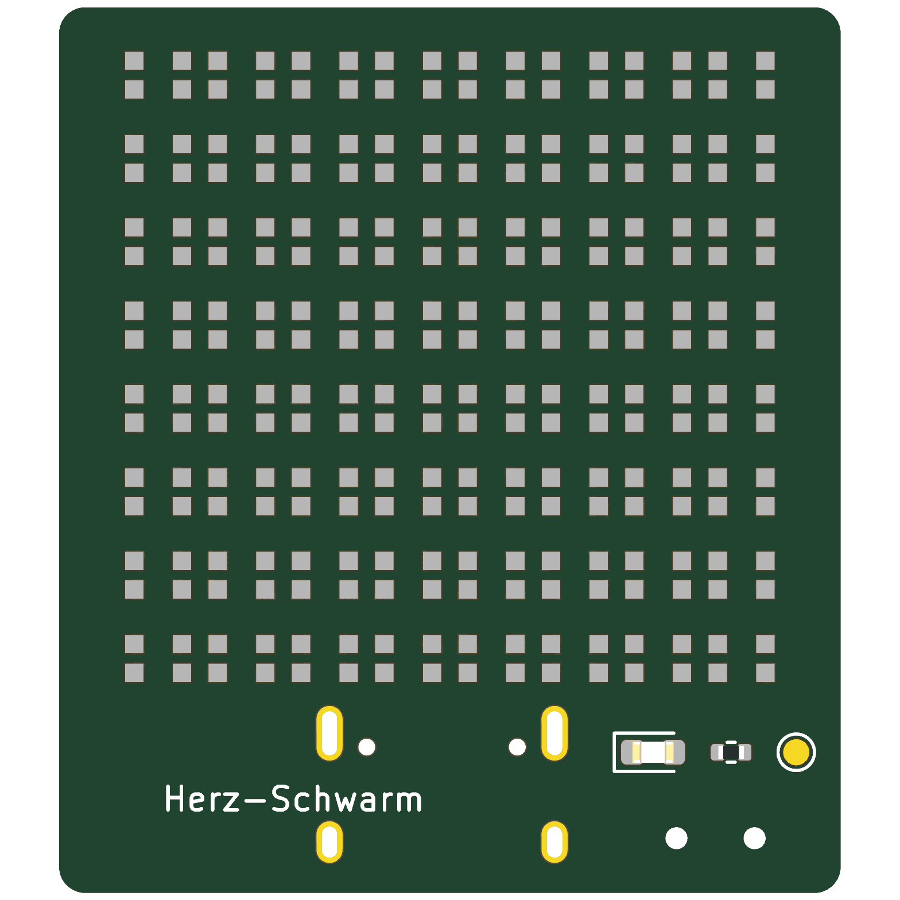
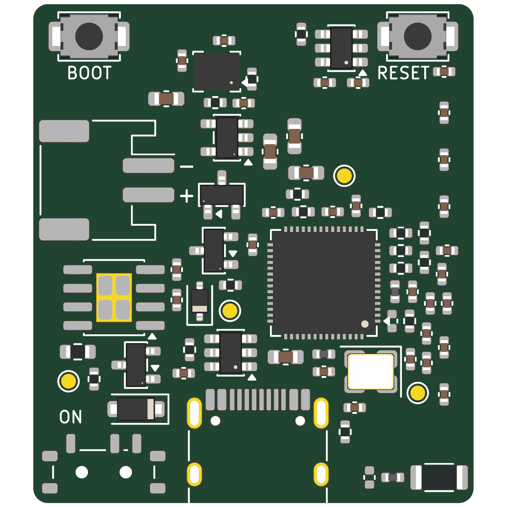

# Herz-Schwarm Badge

Status (2026-10-17): reference board (Waveshare ESP32-S3-Matrix) redrawn and checked against the vendor's netlist.
Battery badge: datasheets summarised (`docs/datasheets/`), power path simulated (`sim/`), parts revised after both,
placed on 30 × 34 mm, 4 layers, not routed; JLC order files for a quote; parts $8.91 per board at 100 (BOM.md).

A battery-powered badge that runs the Herz-Schwarm firmware (`../Herz_Schwarm_CCC_V.ino`) unchanged, slightly larger
than the Waveshare ESP32-S3-Matrix the badges use today. `reference` is the Waveshare board as drawn by its maker;
`badge` is the battery version.




| Folder | Contents |
| --- | --- |
| `boards/badge/` | the battery badge: schematic (`power`, `mcu`, `leds`) and placed board, both generated |
| `boards/reference/` | the Waveshare board in KiCad: root sheet plus `power`, `mcu`, `leds`; schematic only, generated |
| `design/reference-netlist.json` | the vendor netlist, read from the bookmarks of Waveshare's schematic PDF |
| `lib/` | project symbols (QMI8658A), footprints (Walsin RFANT3216120A5T antenna, LED without silk) |
| `scripts/` | `sch_badge.py`, `place_badge.py`, `bom_cost.py`, `fetch_datasheets.py`; `vendor_netlist.py`, `sch_reference.py`, `check_reference.py`; `builder.py` is the pcb-kit glue |
| `sim/` | ngspice power-path simulations (runtime, charging, white-flash sag, USB unplug) and their results |
| `docs/previews/` | `badge/` by `pcbkit previews` (+ `ratsnest.png` by `pcbkit place-score`); `reference/schematic.pdf` by kicad-cli |
| `docs/datasheets/` | datasheet summaries with page references ([index](docs/datasheets/README.md)); the PDFs are fetched, not kept |

Regenerate the badge and its quote files:

```bash
python3 scripts/sch_badge.py && pcbkit erc boards/badge/badge.kicad_sch   # both scripts refuse to run while KiCad has the board open
python3 scripts/place_badge.py        # rebuilds the unrouted board; prints courtyard overlaps
pcbkit drc boards/badge/badge.kicad_pcb           # 0 errors expected; unconnected nets until routed
pcbkit previews boards/badge/badge.kicad_pcb docs/previews/badge
pcbkit fab boards/badge/badge.kicad_pcb build/fab/badge
cd boards/badge && bomi import kicad badge.kicad_pro --replace && bomi list --check && cd ../.. && python3 scripts/bom_cost.py boards/badge
python3 scripts/fetch_datasheets.py   # datasheet PDFs into docs/datasheets/
uv run --no-project --with matplotlib python sim/runtime.py   # and charge.py, flash_sag.py, unplug.py
```

Regenerate and check the reference:

```bash
python3 scripts/sch_reference.py      # writes boards/reference/*.kicad_sch through konnect
python3 scripts/check_reference.py    # KiCad netlist vs design/reference-netlist.json, pin for pin
pcbkit erc boards/reference/reference.kicad_sch
kicad-cli sch export pdf -o docs/previews/reference/schematic.pdf boards/reference/reference.kicad_sch
cd boards/reference && bomi import kicad reference.kicad_pro && bomi status
```

See [DESIGN.md](DESIGN.md), [LAYOUT.md](LAYOUT.md), [PRODUCTION.md](PRODUCTION.md), [BOM.md](BOM.md).
